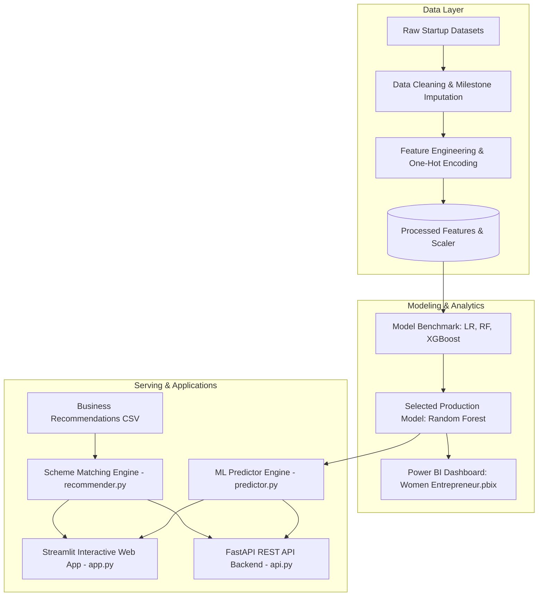

# 👩‍💼 Women Entrepreneur Success Prediction & Business Recommendation System

> **An End-to-End Machine Learning, Data Analytics, and Web Platform Designed to Empower Rural & Semi-Urban Women Entrepreneurs.**

[](https://www.python.org/)
[](https://fastapi.tiangolo.com/)
[](https://streamlit.io/)
[](https://scikit-learn.org/)
[](LICENSE)

---

## 🌟 Executive Summary & Mission

Women entrepreneurs in rural and semi-urban ecosystems face unique systemic hurdles, including limited exposure to market demand trends, low financial literacy regarding government welfare subsidies, and high vulnerability to early venture failure.

This project delivers a dual-solution data platform:
1. **Curated Rural Business Recommender:** Suggests high-demand, low-to-medium risk micro-enterprise ideas tailored to the woman entrepreneur's available investment capital and interests, while matching each business with applicable Indian Government financing schemes (*MUDRA Yojana*, *PMEGP*, *Stree Shakti*, *Mahila Udyam Nidhi*, and *Stand Up India*).
2. **ML Venture Success Predictor:** Employs a machine learning classifier (Random Forest with **77% Accuracy and 0.843 ROC-AUC**) to evaluate operational factors (milestone timing, partnership networks, capital allocation) and forecast the enterprise's long-term sustainability.
3. **Power BI Executive Dashboard:** Detailed interactive dashboard (`Women Entrepreneur.pbix`) visualizing demographic distributions, industry sector analysis, and funding patterns.

---

## 🏗️ System Architecture



---

## 📊 Machine Learning Model Benchmark

Three models were evaluated during training:

| Model | Accuracy (%) | ROC-AUC | F1-Score | Precision | Recall | Selected for Deployment |
| :--- | :---: | :---: | :---: | :---: | :---: | :---: |
| **Random Forest Classifier** | **77.0%** | **0.843** | **0.77** | **0.77** | **0.77** | **Yes (Production)** |
| **XGBoost Classifier** | 75.0% | 0.814 | 0.74 | 0.74 | 0.75 | No |
| **Logistic Regression** | 72.0% | 0.810 | 0.73 | 0.76 | 0.72 | No |

### 📌 Top Drivers of Venture Success
Analysis of Random Forest feature importances reveals the most critical levers:
1. **Age of Last Milestone reached (15.5%)**: Ventures that consistently achieve operational goals survive longer.
2. **Relationships & Mentorship Network (13.6%)**: Stronger community ties and institutional partnerships directly lower failure risk.
3. **Total Funding / Capital Structure (10.6%)**: Early financial stability prevents cash-flow disruptions.
4. **Funding Rounds & Milestone Velocity (10.4%)**: Stepwise expansion outperforms premature scaling.

---

## 🏛️ Integrated Government Financial Schemes

| Scheme Name | Target Audience & Benefit |
| :--- | :--- |
| **Pradhan Mantri MUDRA Yojana (PMMY)** | Micro-finance loans up to ₹10 Lakhs (Shishu, Kishore, Tarun) for non-farm micro-enterprises with no collateral. |
| **PMEGP** | Credit-linked capital subsidy ranging from 25% to 35% of total project cost for rural micro-enterprises. |
| **Stree Shakti Package (SBI)** | Lower margin requirements and discounted interest rates for enterprises where women hold at least 50% equity. |
| **Mahila Udyam Nidhi (SIDBI)** | Soft loan equity assistance up to ₹10 Lakhs for setting up new MSME units with 10-year flexible repayment. |
| **Stand-Up India Scheme** | Bank financing between ₹10 Lakhs and ₹1 Crore for greenfield commercial initiatives led by women. |

---

## 📁 Repository Structure

```
├── Cleaned dataset/
│   ├── business_recommendations.csv     # Curated rural business ideas & matched schemes
│   ├── feature_importance.csv           # Model feature weighting metrics
│   ├── model_performance.csv            # LR vs RF vs XGBoost benchmark data
│   ├── startup_final.csv                # Final cleaned, encoded dataset
│   └── Women Entrepreneur.pbix          # Power BI interactive reporting dashboard
├── Datasets/
│   └── SUCCESS PREDICTION/
│       └── startup data.csv             # Raw input dataset
├── DATA_CLEANING.ipynb                  # Data preprocessing and missing value imputation
├── ENCODING AND FEATURING ENGINEERING.ipynb # One-hot encoding & feature selection
├── Model training.ipynb                 # ML pipeline, tuning, and pickle export
├── best_model.pkl                       # Serialized Random Forest model
├── scaler.pkl                           # Fitted StandardScaler
├── confusion_matrix.png                 # Evaluation confusion matrix plot
├── roc_curve.png                        # Evaluation ROC curve plot
├── recommender.py                       # Business idea & govt scheme matching engine
├── predictor.py                         # Model prediction and insight generator
├── database.py                          # Submissions SQLite database manager
├── app.py                               # Full-featured Streamlit interactive web app
├── api.py                               # FastAPI REST backend with Swagger documentation
├── run_streamlit.bat                    # One-click launcher for Streamlit App (Windows)
├── run_api.bat                          # One-click launcher for FastAPI Backend (Windows)
├── requirements.txt                     # Pinned project dependencies
├── .gitignore                           # Git exclusion rules
└── README.md                            # Comprehensive project documentation
```

---

## 🚀 How to Run Locally

### 1. Prerequisites
Ensure you have **Python 3.10+** installed on your system.

### 2. Clone the Repository
```bash
git clone https://github.com/<your-username>/<your-repo-name>.git
cd "WOMEN ENTREPRENEUR SUCCESS PREDICTION AND BUSINESS RECOMMENDATION PROJECT"
```

### 3. Install Dependencies
```bash
pip install -r requirements.txt
```

### 4. Run the Streamlit Interactive Web Application
You can run the web dashboard with either:
- **One-Click**: Double-click `run_streamlit.bat` in Windows Explorer.
- **Or via Command Line**:
  ```bash
  streamlit run app.py
  ```
The dashboard will open automatically in your browser at `http://localhost:8501`.

### 5. Run the FastAPI REST Backend
You can launch the backend API with either:
- **One-Click**: Double-click `run_api.bat` in Windows Explorer.
- **Or via Command Line**:
  ```bash
  uvicorn api:app --reload --host 127.0.0.1 --port 8000
  ```
- **Interactive Swagger Documentation:** Open `http://127.0.0.1:8000/docs` in your browser to inspect and test all API endpoints live.

---

## 🔌 API Endpoints Reference

| Method | Endpoint | Description |
| :--- | :--- | :--- |
| `GET` | `/` | API status and root service metadata |
| `GET` | `/api/recommendations` | Filter ideas by `budget` (INR), `category`, and `risk_level` |
| `POST` | `/api/predict` | Predict success probability and get strategic advice |
| `GET` | `/api/schemes` | Returns dictionary of Indian government financial schemes |
| `GET` | `/api/submissions` | Returns all stored user submissions from the backend database |
| `GET` | `/api/metrics` | Returns model performance and feature importance statistics |

---

## 📜 License
This project is open-source and available under the [MIT License](LICENSE).
